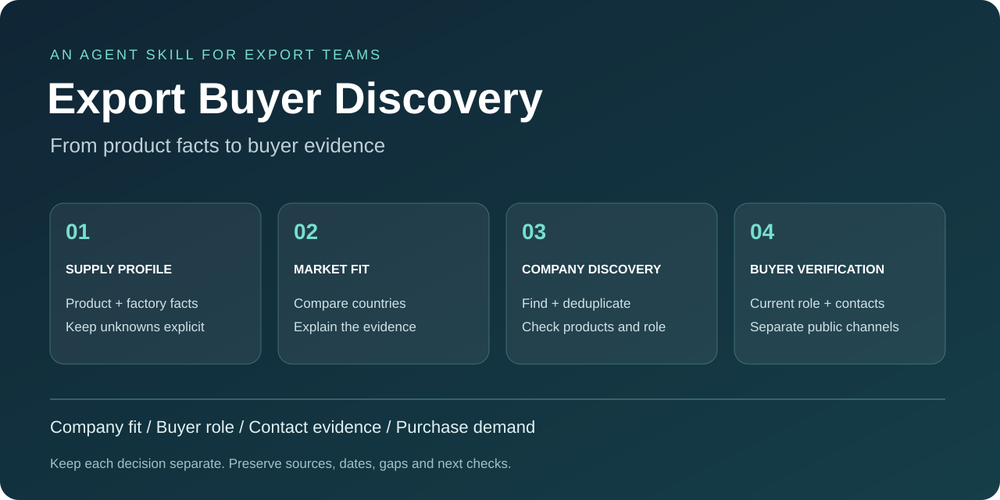

# 海外采购商开发 · Export Buyer Discovery

[English](README_EN.md) · [完整四步流程](references/四步工作流.md) · [使用示例](docs/usage-examples.md)

**提供产品和工厂资料，让支持工具调用的AI助手先比较适合的市场，再发现采购公司，逐层核验采购人和公开商务联系方式。**

适合出口工厂、外贸团队及采购商开发人员。没有初始客户名单也能开始；已有名单可用于去重与补证。



*这是本Skill的真实流程示意，不是产品界面截图或获客效果证明。*

## 解决什么问题

把零散搜索结果变成可追溯、可继续维护的采购商开发资料，避免将公司公共邮箱误认作采购人直邮，或将产品匹配误认作当前采购需求。

- 产品与工厂能力先整理，不编造价格、MOQ或认证。
- 比较候选国家的需求、渠道、竞争、物流及准入；推荐有依据，也列未知项。
- 多渠道先找公司，再与旧库去重、核具体产品与经营证据。
- 公司资格、现任采购职责、品类权限、联系方式和需求分别判断。

**当前状态：公开Alpha工作流。** 固定源码版本：[`v0.1.0-alpha.1`](https://github.com/slalomboy/export-buyer-discovery/tree/v0.1.0-alpha.1)。版本源：[VERSION](VERSION)。这是Agent Skill，不是自带数据库的采集软件；没有无人值守采集器，也不承诺找到所有采购个人邮箱或WhatsApp。

## 看一次输出

[已生成的结构示例](examples/sample-output.md)展示了最终资料的组织方式；示例公司及数据均为虚构，只用于说明字段，不代表真实买家或市场调研。

|资料|内容|
|---|---|
|产品与工厂档案|事实、供货条件、资料来源和缺口|
|市场适配表|候选国家、逐维度判断、推荐理由、证据及未知项|
|公司主表|主体、官网、商业角色、产品/经营证据、评级、去重|
|采购人与联系表|现任、职责、品类权限；采购个人/其他人员/公司公共联系方式|
|证据与执行记录|来源日期、未核原因、下一步、渠道贡献、实际费用和续跑断点|

## 安装

需要Git和支持文件型Skill的AI环境。以下为Codex的macOS/Linux shell安装路径：

```bash
git clone --branch v0.1.0-alpha.1 --depth 1 https://github.com/slalomboy/export-buyer-discovery.git "${CODEX_HOME:-$HOME/.codex}/skills/export-buyer-discovery"
```

如果目标目录已存在，先检查已有版本，不覆盖。安装后重新打开Codex会话，再显式调用 `$export-buyer-discovery`。Windows用户可用Git Bash执行同一命令，或按环境要求导入整个目录；Windows路径安装尚未实测。

已验证范围和首次调用说明见[快速开始](docs/quickstart.md)。其他Agent可读取根目录SKILL.md及其references；自动发现方式以各自客户端为准。

## 第一次使用

把下面内容交给助手，并附产品目录/图片与工厂介绍：

> 使用 $export-buyer-discovery。我想从零开发海外采购商。请先整理我提供的产品和工厂资料，比较适合的国家，再引导我选择本批市场，之后找公司并核采购人、工作邮箱与WhatsApp。先不要发送信息；缺少资料时只问最关键的问题。

最少输入：可辨认的产品及用途/规格、工厂或供货主体介绍。价格、MOQ、包装、交期、认证、市场偏好、旧客户表有则补充，未知可留空。用户不必先选国家或准备名单。

## 四步流程

1. **资料整理**：供货画像、客户画像初稿与缺口。
2. **市场适配**：候选国家比较及目标客户类型。尚未选市场时提示选择；已授权按推荐继续则直接推进。
3. **公司发现**：搜索引擎、官网、地图/目录、协会展会、电商主体、供应商入口与LinkedIn搜索等按可用条件组合；去重、核验、评级。
4. **采购人核验**：确认现任与品类职责，查公开商务渠道，交付同一主表、证据、下一步和渠道费用。

默认每批100家新增合格潜在公司，可调整。这不是100家正在采购的买家，也不保证100份采购个人联系方式；资源边界到达则保存缺口继续，不凑数。已有批次从断点续跑。

## 仓库内容

`SKILL.md`为入口；`references/`保存详细流程；`templates/`提供输入及客户/证据/费用字段；`examples/`是明确标注的虚构结构示例；`docs/`包含快速开始、使用场景及中英上架文案；`assets/`是原创流程图；`scripts/check_package.py`检查版本、引用及公开包安全边界。

## 限制、工具与费用

- 本包只有指令、文档、模板和检查脚本；AI模型、网页搜索/浏览、表格工具由使用环境提供。未接入任何商业联系人库、海关API或邮箱验证API。
- LinkedIn登录墙/限流可能导致字段不可见，搜索索引不能替代完整履历。不要绕过验证码或平台限制。
- 海关数据为可选补证，须核国家覆盖及贸易方向，历史交易不证明当前采购需求。
- MX不证邮箱存在，手机号码不证WA开通；公开WA也不代表可达或联系许可。本包不试发、不恢复遮蔽联系方式。
- 不含广告获客、社媒运营、自动加好友、邮件或WA发送、供应商表单提交。
- 源码许可免费不代表模型、搜索、数据购买和人工费用免费。执行前登记资源与费用边界，未知费用如实标注。

## 验证与隐私

本版验证文件结构、引用、公开资料扫描和隔离目录安装；不等于自动发现界面已测试、市场判断准确率已验证或有真实回复/成交效果。[验证记录](repository-audit-report.md)。

仓库不含真实客户名单、个人联系值、账号凭据或内部业务路径。运行时输出保存到用户指定位置；不要把真实客户表提交到本公开仓库。使用云模型或第三方补全服务前，遵从用户已授权的数据范围。缺失证据不猜补。

## 许可证与来源

维护者：大林·AI开物（Dalin AI Works）。许可证：[Apache-2.0](LICENSE)，经权利人本次明确选择。

本包为独立编写的工作流、模板与原创流程示意。公开工作流调研仅作为方法参考，未复制第三方Skill正文或代码；详见[来源说明](docs/provenance.md)。

问题反馈：[GitHub Issues](https://github.com/slalomboy/export-buyer-discovery/issues)。反馈请使用脱敏或虚构资料。此版本提供固定源码Tag；未创建GitHub Release。
