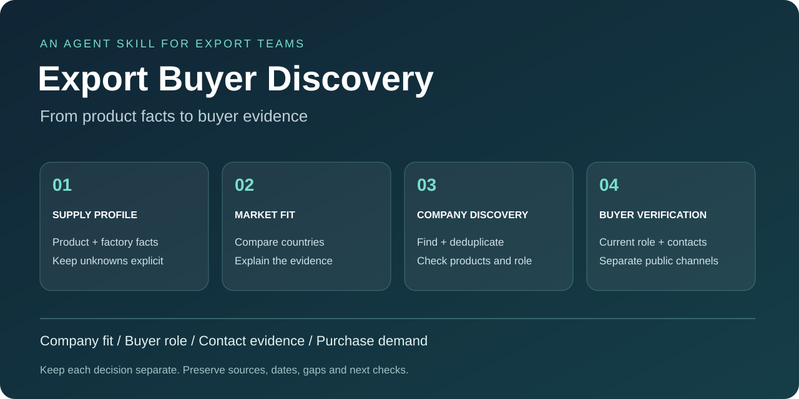

# Export Buyer Discovery

[中文](README.md)

Turn product and factory information into market-fit research, deduplicated company prospects, and evidence-backed buyer contact records.



This is an original workflow diagram, not a product screenshot or evidence of lead-generation results.

## What it solves

For export factories and trade teams starting without a customer list, this Agent Skill separates company fit, current purchasing roles, category authority, contact ownership, and confirmed demand. A public company inbox never becomes a buyer's personal address merely to fill a field.

Status: public Alpha workflow. Fixed source: [v0.1.0-alpha.1](https://github.com/slalomboy/export-buyer-discovery/tree/v0.1.0-alpha.1). It is not a standalone scraper, contact database or outreach service.

## Output example

See the [generated, explicitly fictional structural example](examples/sample-output.md). Outputs include a supply profile, candidate-country comparison, company register, contact register, evidence records, and channel/cost log. Fictional rows are not verified buyers or market evidence.

## Installation

Git and a file-based Skill-capable agent are required. For Codex in a macOS/Linux shell:

```bash
git clone --branch v0.1.0-alpha.1 --depth 1 https://github.com/slalomboy/export-buyer-discovery.git "${CODEX_HOME:-$HOME/.codex}/skills/export-buyer-discovery"
```

Do not overwrite an existing directory. Reopen your Codex session, then invoke `$export-buyer-discovery`. Isolated installation is checked; automatic client discovery and Windows-specific paths are not end-to-end tested. Other agents may read SKILL.md and its references directly; automatic discovery varies by client.

## Quick start

Attach product information and a factory/supplier introduction, then ask:

> Use $export-buyer-discovery. Start with my product and factory materials, compare suitable countries, help me select a market, discover companies and verify current purchasing roles and public business contacts. Do not send messages. Ask only for the missing information that affects the next decision.

Optional inputs: price/currency/trade terms, MOQ, packaging, lead time, certifications, excluded markets, prior customer register, batch size and spending limits. Unknown values remain unknown.

## Workflow and outputs

1. Normalize product and supplier facts; produce a supply profile and information gaps.
2. Compare candidate markets on demand, channels, competition, logistics, entry requirements and supplier fit. Source current claims; do not invent landed margins or compliance.
3. Discover companies through available search, websites, maps/directories, associations/events, brand tracing, vendor portals and LinkedIn searches. Deduplicate against the available old register, validate fit and grade evidence.
4. Check identity, current role and category authority separately; distinguish purchasing-person, other named-business and shared-company contacts. Update one master register with sources, unresolved reasons, next checks and channel costs.

Default batch target: 100 new qualifying potential companies, adjustable by the user. It is not a promise of 100 active buyers or 100 personal emails/WhatsApp numbers. Save progress at resource limits and resume the same batch.

## Limitations, tools and privacy

The package does not include model access, web tools, paid databases, customs coverage, email verification APIs, ads, social publishing or sending. Those capabilities and costs depend on the user's environment and authorization. LinkedIn login walls and missing evidence remain explicit limitations. MX is not mailbox proof; a phone number is not WhatsApp proof; public contact information is not permission to send.

Do not upload actual customer records to this public repository. Keep outputs in the user's chosen location and respect the authorized scope of cloud-model and enrichment services. No response, revenue or conversion claims have been validated. [Audit scope](repository-audit-report.md).

## Files and support

SKILL.md is the entrypoint. references holds the detailed Chinese workflow; templates contains input and CSV schemas; examples contains fictional structure only; docs contains quickstart, scenarios and bilingual listing copy; assets contains the original diagram. The English README and invocation are available; the detailed operational reference is currently in Chinese.

Maintainer: Dalin AI Works. Report issues through [GitHub Issues](https://github.com/slalomboy/export-buyer-discovery/issues) using redacted information.

## License and provenance

[Apache-2.0](LICENSE), explicitly selected by the owner. Original workflow, templates, diagram and package-check script. External workflows informed method research; no third-party Skill text or code is bundled. See [provenance](docs/provenance.md). This version has a fixed source Tag; no GitHub Release has been created.
